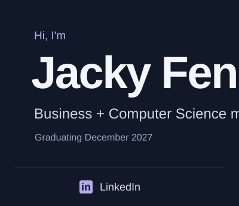
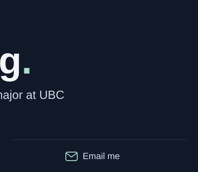
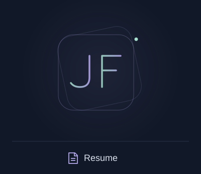

<!-- Custom artwork; technology logos from Skill Icons (see assets/CREDITS.md). -->

Welcome! 👋 I'm Jacky, a fourth-year Business and Computer Science major at UBC. I enjoy building useful software and understanding the business problems it helps solve.

Previously, I interned in cloud security at **SAP** and DevOps at **Optum**. I'm now a **teaching assistant at UBC**, helping students learn software engineering. I enjoy working through tricky problems with others and learning along the way.

## Selected projects

**[Prediction Market Arbitrage Engine](https://github.com/jackyfengg/Prediction-Market-Arbitrage-Engine)** 
A C++20 engine that streams order books across **500+ prediction markets** and ranks simulated arbitrage opportunities, with parallel initialization and WebSocket recovery. 
C++20 &nbsp;/&nbsp; Boost.Asio &nbsp;/&nbsp; OpenSSL &nbsp;/&nbsp; CMake

**[FoodHub](https://github.com/jackyfengg/FoodHub)** 
A community recipe platform for discovery, reviews, and cooking events, combining PHP application workflows with relational data and preference analytics. 
PHP &nbsp;/&nbsp; JavaScript &nbsp;/&nbsp; SQL

**[AI Pictionary](https://github.com/jackyfengg/AI-Pictionary)** 
An image-guessing game powered by DALL-E 3, built with teammates at nwHacks. Connects a Flask backend to an interactive browser interface. 
Python &nbsp;/&nbsp; Flask &nbsp;/&nbsp; JavaScript

## Toolkit

Languages &amp; frameworks  

Infrastructure &amp; tools  

